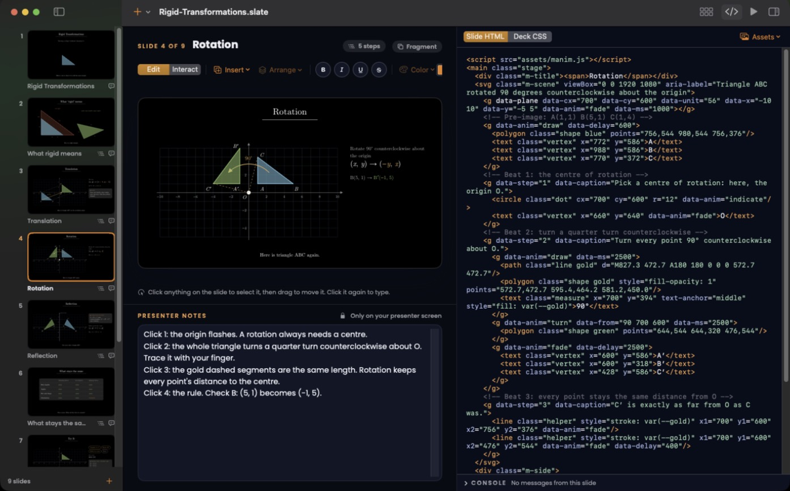
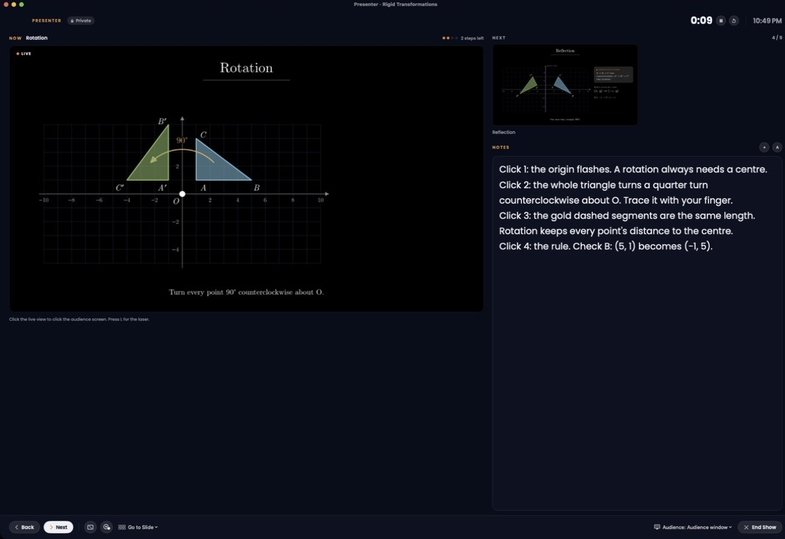
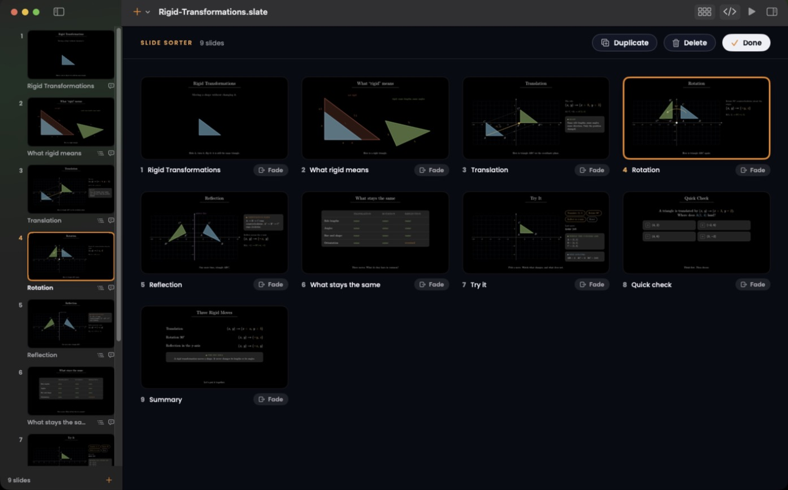

# Slate

**Presentations made of web pages.** Slate is a macOS presentation app where every slide is HTML, CSS and JavaScript, so a slide can quiz, poll, count down, chart or animate. Your presenter notes stay on your screen only.


*A demo lesson, Rigid Transformations, designed with the `slate-deck` skill: each beat animates on a click.*

## Download

**[Download Slate for Mac](https://github.com/iamjashmer/slate-releases/releases/latest/download/Slate.dmg)** (macOS 15 or later, Apple silicon and Intel)

Every version, with release notes and checksums, is on the [Releases page](https://github.com/iamjashmer/slate-releases/releases).

## Screenshots

**Edit the slide or its HTML.** The slide list, the live slide, presenter notes and the slide's code side by side.



**Present with private notes.** The presenter view shows the live slide, the next slide, your notes and a timer. The audience sees only the slide.



**See the whole deck.** The slide sorter shows every slide at once for reordering.



## Install

1. Open `Slate.dmg` and drag **Slate** to **Applications**.
2. This build is not notarized by Apple yet. The first time, right-click Slate in Applications and choose **Open**, then **Open** again. (Or open it once, then go to System Settings › Privacy & Security and press **Open Anyway**.) After that it opens normally.

To check the download, compare `shasum -a 256 Slate.dmg` with `SHA256SUMS.txt` on the release.

## Design decks with Claude Code

The free [`slate-deck` skill](https://github.com/iamjashmer/slate-deck) designs a whole deck as files, checks it, and opens it in Slate:

```bash
git clone https://github.com/iamjashmer/slate-deck.git ~/.claude/skills/slate-deck
```

## About this repository

This repository only hosts Slate's downloads; the app's source code is not public. Slate is free to download and use.

© 2026 April Jashmer Anting. All rights reserved. Poppins typeface © 2020 The Poppins Project Authors, under the SIL Open Font License 1.1.
